<div align="center">

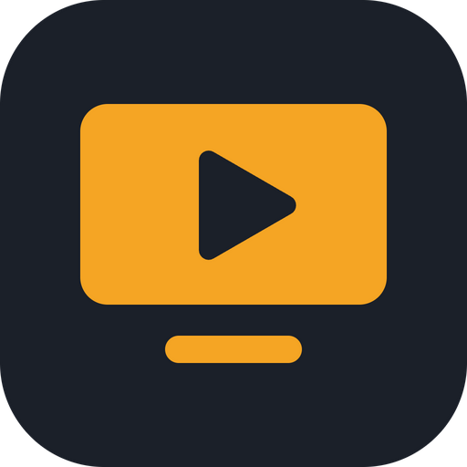

# MeuDisc

**Uma sala privada para você e até 7 amigos: voz, câmera, tela em até 120 fps e um navegador que todo mundo usa junto.**

Tudo vai direto de um computador para os outros (P2P). Sem conta, sem servidor no meio da transmissão.

[](https://github.com/gabrielsoares97/meudisc/releases/latest)


[](LICENSE)

[**Baixar**](#-baixar) · [Como usar](#-como-usar) · [Celular](#-no-celular-android) · [120 fps](#-sobre-os-120-fps) · [Desenvolver](#-para-desenvolver)

<br>

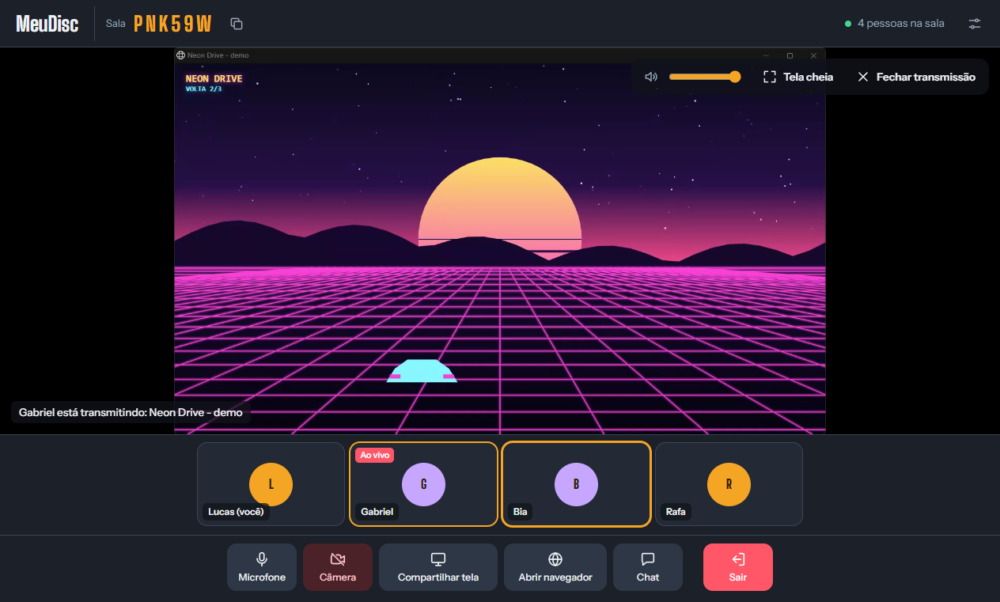

</div>

---

## Índice

- [Destaques](#-destaques)
- [Baixar](#-baixar)
- [Instalar](#-instalar)
- [Como usar](#-como-usar)
  - [1. Criar uma sala](#1-criar-uma-sala)
  - [2. Chamar os amigos](#2-chamar-os-amigos)
  - [3. Na sala](#3-na-sala)
  - [4. Compartilhar a tela](#4-compartilhar-a-tela)
  - [5. Assistir transmissões](#5-assistir-transmissões)
  - [6. Navegador compartilhado](#6-navegador-compartilhado)
  - [7. Chat](#7-chat)
  - [8. Configurações](#8-configurações)
- [No celular (Android)](#-no-celular-android)
- [Sobre os 120 fps](#-sobre-os-120-fps)
- [Se não conectar](#-se-não-conectar)
- [Como funciona](#-como-funciona)
- [Para desenvolver](#-para-desenvolver)
- [Privacidade](#-privacidade)
- [Licença](#-licença)

---

## ✨ Destaques

| | |
|---|---|
| 🎙️ **Voz e câmera** | Até 8 pessoas na mesma sala, com volume separado para cada uma. |
| 🖥️ **Tela em até 120 fps** | No Windows, a tela inteira é capturada direto da placa de vídeo (DXGI) e acompanha a taxa do monitor. |
| 🔊 **Som só do jogo** | Ao compartilhar uma janela, vai só o som daquele programa. A voz dos amigos não volta como eco. |
| 🌐 **Navegador compartilhado** | Um navegador dentro da sala que todo mundo pode clicar, digitar e rolar. Com bloqueio de anúncios. |
| 💬 **Chat** | Mensagens de texto na sala, com aviso de mensagem nova. |
| 📱 **Celular** | App Android para entrar na sala, falar, assistir as transmissões e mexer no navegador. |
| 🔒 **Direto entre vocês** | Conexão P2P (WebRTC). Ninguém cria conta, e o servidor só serve para as pessoas se acharem. |
| 🔁 **Sala que não cai** | Se quem criou sair, outra pessoa assume e o código continua valendo. |

---

## 📦 Baixar

Os pacotes ficam na página de [**versões (Releases)**](https://github.com/gabrielsoares97/meudisc/releases/latest):

| Sistema | Arquivo |
|---|---|
| 🪟 Windows 10 / 11 | [`MeuDisc-Windows.zip`](https://github.com/gabrielsoares97/meudisc/releases/latest/download/MeuDisc-Windows.zip) |
| 🍎 Mac com chip M1, M2, M3, M4… | [`MeuDisc-Mac-AppleSilicon.zip`](https://github.com/gabrielsoares97/meudisc/releases/latest/download/MeuDisc-Mac-AppleSilicon.zip) |
| 🍎 Mac com processador Intel | [`MeuDisc-Mac-Intel.zip`](https://github.com/gabrielsoares97/meudisc/releases/latest/download/MeuDisc-Mac-Intel.zip) |
| 🤖 Android 8 ou mais novo | [`MeuDisc-Android.apk`](https://github.com/gabrielsoares97/meudisc/releases/latest/download/MeuDisc-Android.apk) |

> [!IMPORTANT]
> Todo mundo na sala precisa estar com a mesma versão. A versão atual (salas de até 8 pessoas) não conversa com a antiga, que era só para 2.

---

## 🛠️ Instalar

<details open>
<summary><b>Windows</b></summary>

1. Clique com o botão direito em `MeuDisc-Windows.zip` → **Extrair tudo**.
2. Abra a pasta `MeuDisc` e dê dois cliques em `MeuDisc.exe`.
3. Se aparecer **"O Windows protegeu o computador"**, clique em **Mais informações** → **Executar assim mesmo**. Isso aparece porque o app não tem assinatura paga da Microsoft.

Dica: botão direito em `MeuDisc.exe` → **Enviar para** → **Área de trabalho (criar atalho)**.

</details>

<details>
<summary><b>Mac</b></summary>

1. Dê dois cliques no `.zip` para extrair e arraste o **MeuDisc.app** para **Aplicativos**.
2. Como o app não tem assinatura paga da Apple, o macOS bloqueia na primeira vez. Abra o **Terminal** (Cmd+Espaço, digite Terminal), cole a linha abaixo e aperte Enter:

   ```bash
   xattr -cr /Applications/MeuDisc.app && codesign --force --deep --sign - /Applications/MeuDisc.app && open /Applications/MeuDisc.app
   ```

3. Permita o acesso ao microfone e à câmera quando o app pedir.
4. Para compartilhar a tela: **Ajustes do Sistema → Privacidade e Segurança → Gravação de Tela** e ligue o MeuDisc. O próprio app mostra um botão que abre essa tela.

</details>

<details>
<summary><b>Android</b></summary>

1. Mande o `MeuDisc-Android.apk` para o celular (WhatsApp como documento, Google Drive ou cabo USB).
2. Abra o arquivo no celular. Se o Android pedir, permita **"instalar apps desta fonte"**.
3. Abra o MeuDisc e permita microfone e câmera.

</details>

---

## 🚀 Como usar

### 1. Criar uma sala

Escreva seu nome e clique em **Criar sala**.

<p align="center">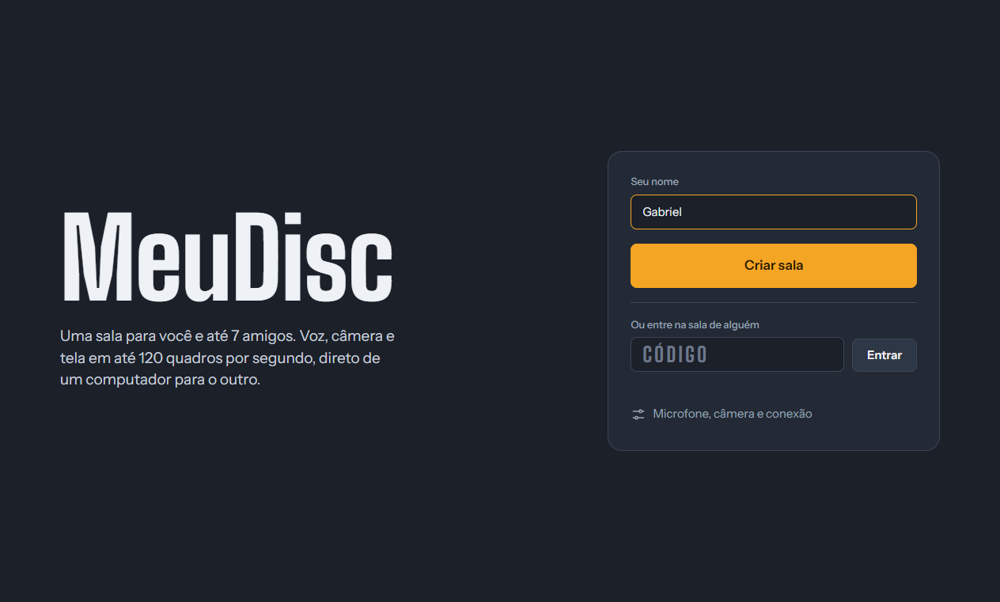</p>

### 2. Chamar os amigos

Aparece um código de 6 letras. Clique em **Copiar convite** e mande para seus amigos. Cada um abre o MeuDisc, digita o código em **Ou entre na sala de alguém** e clica em **Entrar**.

<p align="center">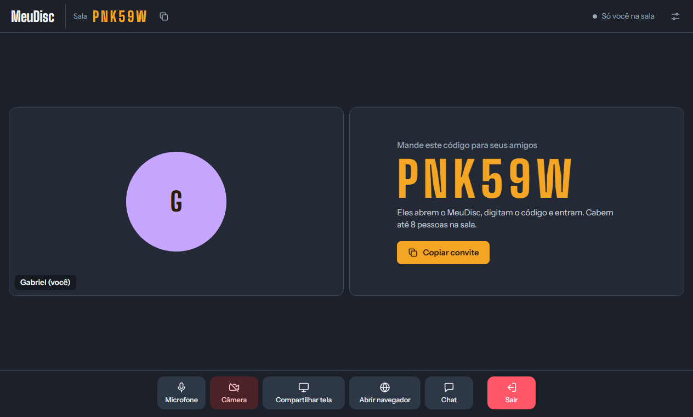</p>

### 3. Na sala

Cada pessoa aparece num bloco. A borda acende quando ela está falando. Passe o mouse no bloco de alguém para mudar o volume só daquela pessoa. No topo aparece quantas pessoas estão na sala e o estado da conexão.

<p align="center">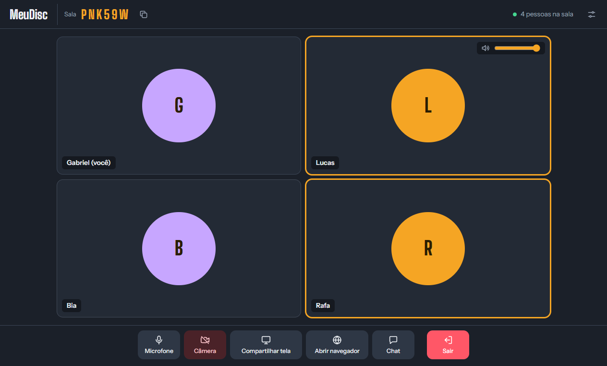</p>

A barra de baixo tem tudo que você precisa:

| Botão | O que faz |
|---|---|
| **Microfone** | Liga e desliga sua voz. |
| **Câmera** | Liga e desliga sua câmera. |
| **Compartilhar tela** | Transmite uma tela inteira ou uma janela para a sala. |
| **Abrir navegador** | Abre um navegador que todo mundo na sala pode usar. |
| **Chat** | Abre as mensagens de texto. |
| **Sair** | Sai da sala. |

### 4. Compartilhar a tela

Clique em **Compartilhar tela**, escolha entre **Telas inteiras** e **Janelas**, ajuste a qualidade e clique em **Compartilhar**. Use **Atualizar lista** se o programa foi aberto depois.

<p align="center">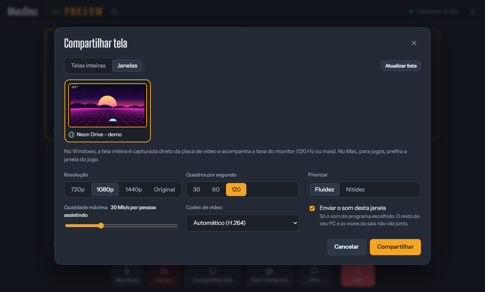</p>

| Opção | Para que serve |
|---|---|
| **Resolução** | 720p, 1080p, 1440p ou a original da tela. |
| **Quadros por segundo** | 30, 60 ou 120. |
| **Priorizar** | *Fluidez* mantém os fps e baixa a resolução se a internet apertar. *Nitidez* faz o contrário (bom para texto e código). |
| **Qualidade máxima** | Limite de Mb/s por pessoa assistindo (20 Mb/s por padrão em 1080p a 120 fps). |
| **Codec de vídeo** | H.264 (usa a placa de vídeo na maioria dos PCs), VP9, AV1 ou VP8. |
| **Enviar o som** | Janela: só o som daquele programa. Tela inteira: tudo que toca no PC, menos o próprio MeuDisc. |

Enquanto você transmite, o painel **Você está transmitindo** mostra quantas pessoas assistem, os fps enviados, a resolução, a taxa, o codificador, o tipo de captura e qual som está indo.

<p align="center">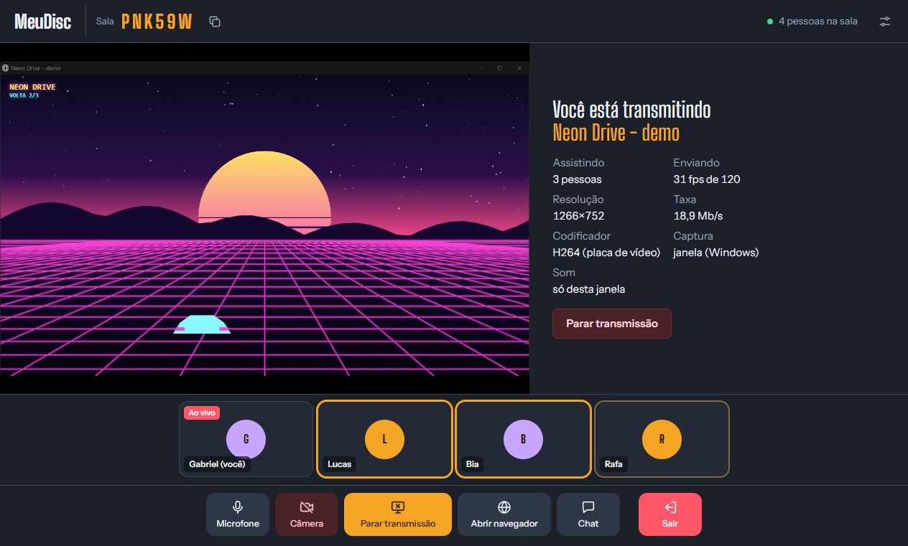</p>

> [!NOTE]
> Nesta foto, quatro cópias do app rodavam no mesmo notebook, por isso só 31 fps. Com cada amigo no próprio PC, a captura de janela chega a 120 fps.

**Som do compartilhamento (Windows 10 21H2 / Windows 11):** compartilhando uma **janela**, vai só o som do programa dela (o jogo, o Chrome, o Spotify…). Compartilhando a **tela inteira**, vai tudo que toca no PC, menos o MeuDisc, então a voz dos amigos não volta para eles. Em Windows mais antigos, vai o som do PC inteiro. No Mac, esta versão envia a imagem sem o som do sistema.

### 5. Assistir transmissões

Quando alguém compartilha a tela, você começa a assistir sozinho. No canto da transmissão ficam o **volume**, **Tela cheia** (ou duplo clique) e **Fechar transmissão**. O som só toca da transmissão que você está assistindo.

<p align="center"></p>

- Se mais de uma pessoa estiver transmitindo, ou se você fechou, clique em **Assistir** no bloco de quem você quer ver.
- Em tela cheia, os botões somem com o mouse parado e voltam quando você mexe. **Esc** sai.
- Se aparecer **Sem som**, quem transmite não está mandando áudio.
- Cada pessoa assistindo recebe uma cópia da transmissão, então quem transmite usa o upload uma vez por pessoa.

### 6. Navegador compartilhado

Clique em **Abrir navegador**. Ele abre dentro do app, no seu computador, e vai para a sala com imagem e som (1280×720, até 60 fps). Todo mundo que está assistindo pode clicar, digitar, rolar e usar a barra de endereço.

<p align="center">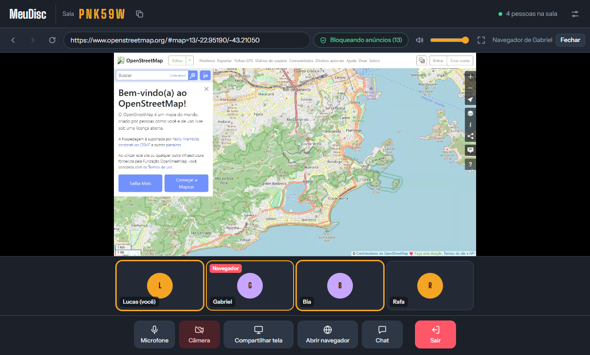</p>

Quem abriu o navegador tem controles a mais: **Todos mexem** ou **Só eu**, o bloqueio de anúncios e **Fechar navegador**.

<p align="center">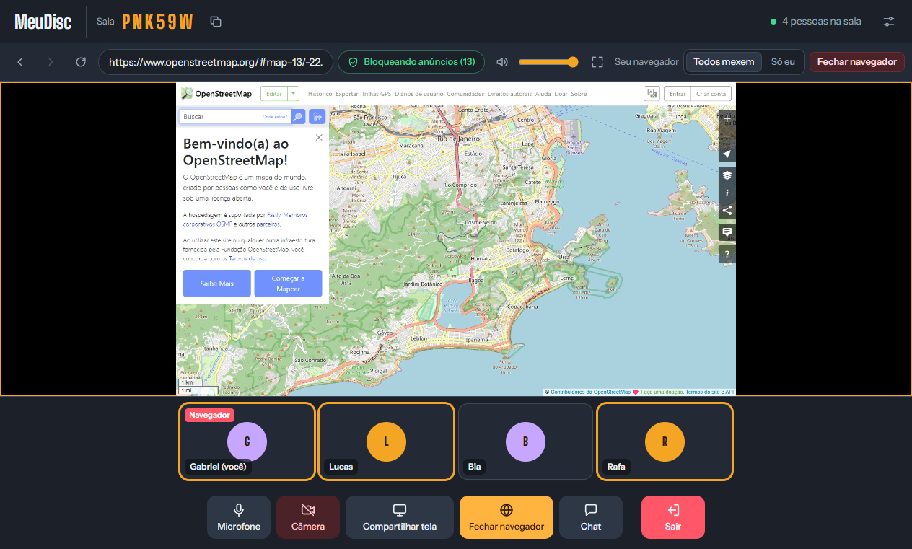</p>

- **Bloqueio de anúncios** ligado por padrão (listas do uBlock Origin / EasyList). O número mostra quantos foram bloqueados.
- **YouTube:** lá o app não bloqueia (o YouTube detecta e atrasa os vídeos). Quando entra um anúncio, ele fica mudo, é acelerado 16× e o "Pular" é clicado sozinho. O YouTube muda isso com frequência, então pode não funcionar sempre.
- Cada pessoa tem o próprio **volume**, **mudo** e **tela cheia**. A tela cheia do próprio YouTube também coloca o app em tela cheia.
- **Ctrl+V** cola o texto de quem está digitando.
- Logins feitos nele ficam salvos no computador de quem abriu.
- Por segurança, os sites abertos nele não acessam seus arquivos, câmera ou microfone e não baixam nada no seu computador.

### 7. Chat

Clique em **Chat** para abrir as mensagens. Quando chega mensagem com o chat fechado, aparece um número no botão.

<p align="center">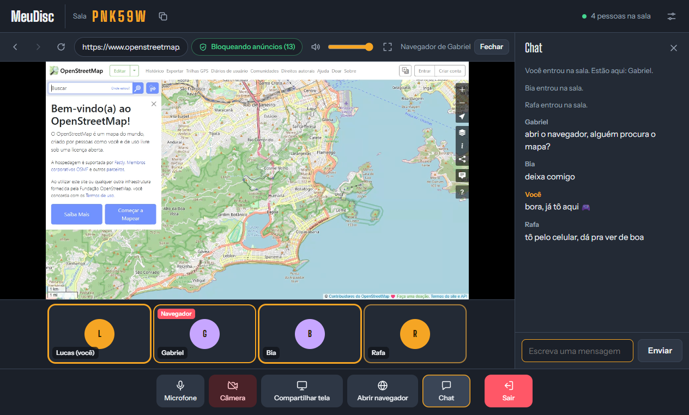</p>

### 8. Configurações

No ícone de ajustes (canto de cima, ou **Microfone, câmera e conexão** na tela inicial) você troca o nome, o microfone, a câmera e a saída de som. Em **Conexão avançada (TURN)** dá para colocar um servidor TURN seu.

<p align="center">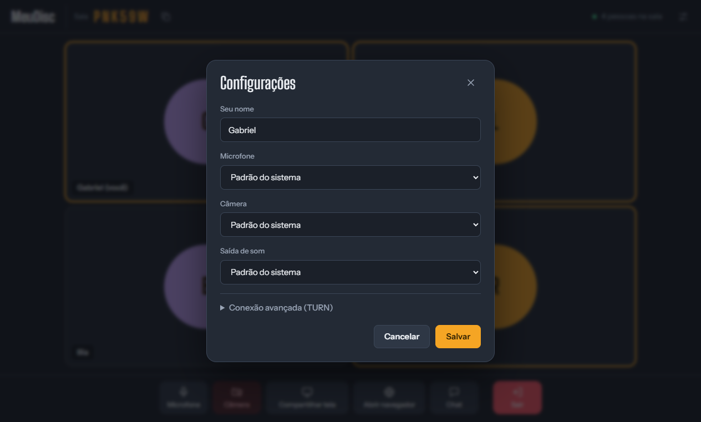</p>

---

## 📱 No celular (Android)

<table>
  <tr>
    <td align="center">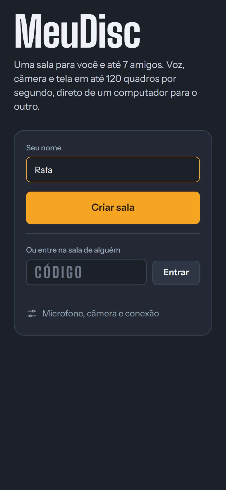<br><sub>Início</sub></td>
    <td align="center">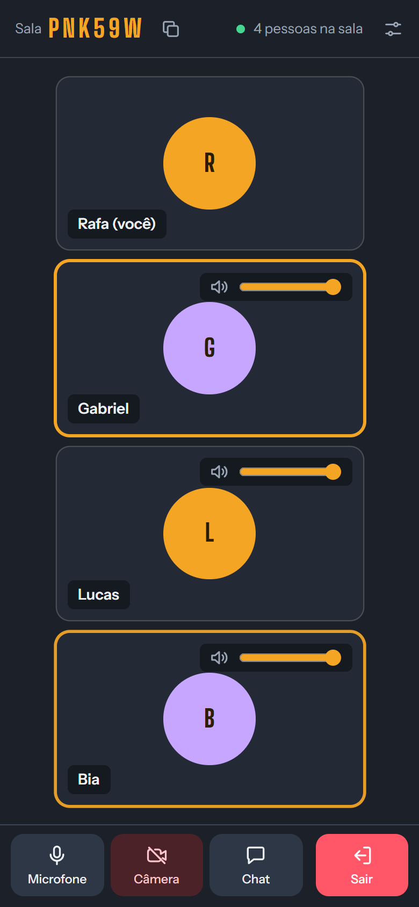<br><sub>Na sala</sub></td>
    <td align="center">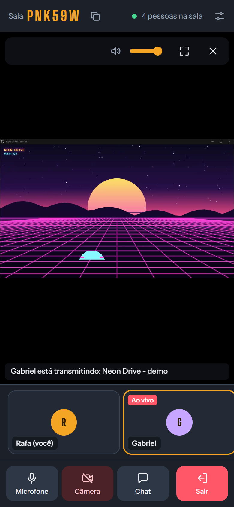<br><sub>Assistindo</sub></td>
    <td align="center">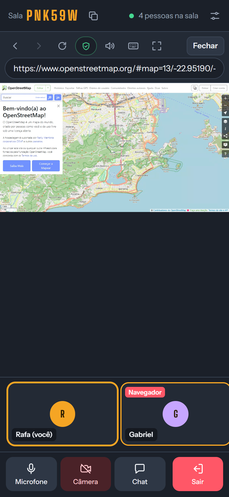<br><sub>Navegador</sub></td>
    <td align="center">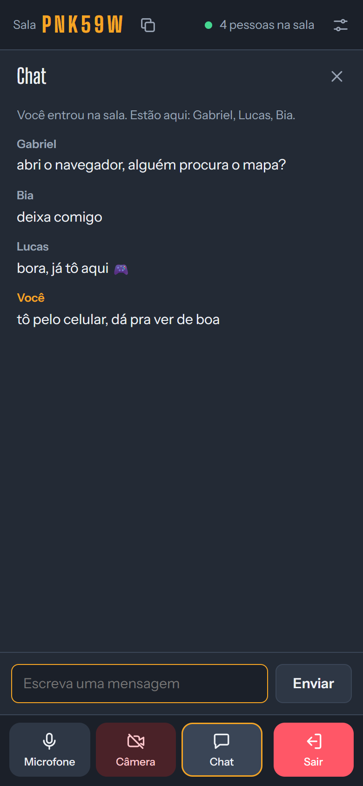<br><sub>Chat</sub></td>
  </tr>
</table>

No celular dá para:

- Criar sala ou entrar com o código. Os amigos podem estar no PC, no Mac ou no celular.
- Usar microfone e câmera. Para trocar entre a câmera da frente e a de trás, vá em **Configurações**.
- Assistir as transmissões. Em **Tela cheia**, o celular deita. O botão voltar sai da tela cheia.
- Mexer no navegador da sala: tocar é clicar e arrastar o dedo rola a página. Ao tocar num campo de texto, o teclado abre sozinho (ou pelo botão de teclado).
- Usar o chat. **Enviar convite** abre o menu de compartilhar (WhatsApp etc.).
- Continuar na chamada com o app em segundo plano ou com a tela desligada. Enquanto você está numa sala aparece uma notificação. O botão voltar não tira você da sala, só **Sair** tira.

No celular não dá para transmitir a tela nem abrir o navegador da sala (ele roda no PC de quem abre).

---

## ⚡ Sobre os 120 fps

- **Tela inteira no Windows:** o app captura direto da placa de vídeo (DXGI Desktop Duplication) e acompanha a taxa do monitor. Num monitor de 165 Hz saem 120 fps em 1920×1080, codificados pela placa NVIDIA. No painel de transmissão, **Captura** mostra "direta da placa de vídeo" quando esse modo está ativo.
- **Janela de jogo:** também chega a 120 fps.
- **Mac:** usa a captura do sistema. Para jogos, prefira compartilhar a janela do jogo.
- Quem assiste precisa de um monitor de 120 Hz ou mais para *ver* os 120 quadros. O número no canto da transmissão mostra quantos estão chegando.
- A captura padrão do Chromium no Windows fica em ~55 fps na tela inteira. Por isso o MeuDisc tem a própria captura.

---

## 🔌 Se não conectar

- O app usa o servidor público gratuito do [PeerJS](https://peerjs.com/) só para as pessoas se acharem. Depois disso, tudo vai direto entre os aparelhos.
- No topo aparece quantas pessoas estão na sala e se alguém está **via servidor de apoio** (funciona, com qualidade menor).
- Em redes muito fechadas (algumas empresas e operadoras), configure um servidor TURN seu em **Configurações → Conexão avançada**.

---

## 🧩 Como funciona

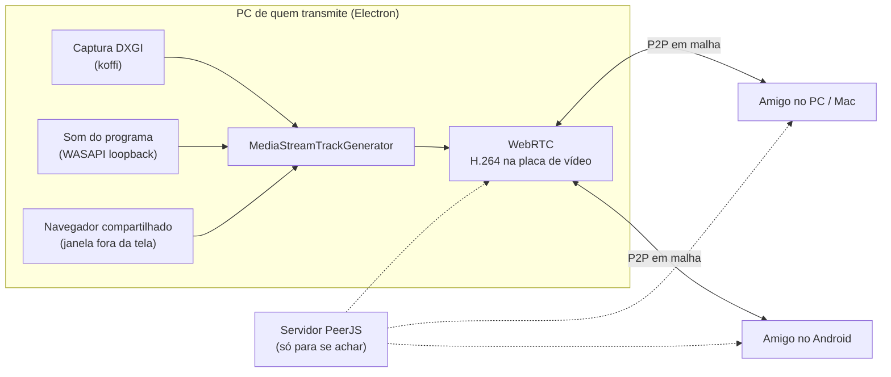

- **Salas:** cada sala tem um código de 6 letras. Cada pessoa se conecta direto com todas as outras (malha), até 8 pessoas.
- **Captura da tela no Windows:** DXGI Desktop Duplication chamado pelo [koffi](https://koffi.dev/), com as texturas entregues pela GPU ao app (`sharedTexture` do Electron).
- **Som por programa:** WASAPI *process loopback* (Windows 10 21H2+), também pelo koffi, em uma thread separada.
- **Navegador compartilhado:** uma janela do Electron fora da tela, com bloqueio de anúncios do [Ghostery adblocker](https://github.com/ghostery/adblocker). Os cliques e teclas de quem assiste chegam pelo canal de dados do WebRTC.
- **Android:** um WebView que abre a mesma interface de `src/`, com uma pequena ponte Java para convite, notificação e botão voltar.

---

## 💻 Para desenvolver

**Precisa de:** [Node.js](https://nodejs.org/) (LTS atual) e Git. Para o APK: Android SDK e JDK 17+.

```bash
git clone https://github.com/gabrielsoares97/meudisc.git
```

```bash
cd meudisc
```

```bash
npm install
```

```bash
npm start
```

O `npm install` também copia o PeerJS e as fontes para `src/vendor/`, então o app funciona sem internet para carregar a interface.

**Testar várias cópias no mesmo PC:** abra cada uma com outro perfil (PowerShell):

```powershell
$env:MEUDISC_PROFILE='b'; npm start
```

### Gerar os pacotes

| Comando | Gera |
|---|---|
| `npm run build` | Windows e os dois Mac, a partir do Windows (não precisa de Mac) |
| `npm run build:win` | Só Windows |
| `npm run build:mac` | Só Mac (Apple Silicon e Intel) |
| `npm run build:android` | O APK, sem Gradle e sem abrir o Android Studio |

Tudo sai em `dist/`.

> [!WARNING]
> Na primeira vez, `npm run build:android` cria a chave que assina o app: `android/meudisc.keystore` e a senha em `android/keystore.properties`. **Guarde esses dois arquivos e não coloque no Git** (já estão no `.gitignore`). Uma versão nova só instala por cima da antiga se for assinada com a mesma chave.

### Estrutura

```
meudisc/
├── main.js                  # janela, permissões, seletor de tela
├── preload.js               # ponte entre a interface e o sistema
├── src/
│   ├── index.html           # interface
│   ├── styles.css
│   └── app.js               # salas, conexões entre as pessoas, interface
├── native/
│   ├── dxgi.js              # captura direta da tela (Windows)
│   ├── capture-worker.js
│   ├── screen-capture.js
│   ├── app-audio.js         # som só da janela escolhida (Windows)
│   ├── audio-worker.js
│   ├── shared-browser.js    # navegador compartilhado
│   ├── adblock.js           # bloqueio de anúncios
│   └── youtube-noads.js     # pulador de anúncios do YouTube
├── android/                 # app de celular (abre a mesma interface de src/)
├── scripts/
│   ├── build.js             # pacotes Windows e Mac
│   ├── build-android.js     # APK
│   ├── vendor.js            # copia PeerJS e fontes para src/vendor
│   └── make-icon.js
├── build/                   # ícones
└── docs/screenshots/        # fotos deste README
```

---

## 🔒 Privacidade

- Voz, vídeo, tela e chat vão direto entre os aparelhos, criptografados pelo WebRTC.
- O servidor do PeerJS só troca os dados para as pessoas se acharem. Se a conexão direta não for possível, a transmissão passa por um servidor de apoio (TURN), ainda criptografada.
- Não tem conta, cadastro nem histórico guardado em servidor.

---

## 📄 Licença

[MIT](LICENSE) © Gabriel Soares
